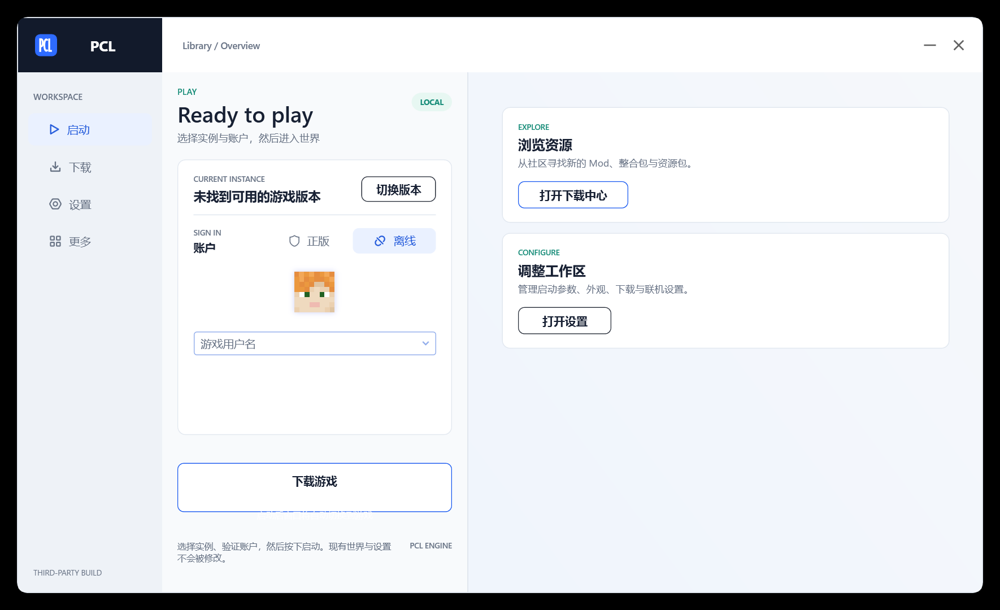

# PCL Workstation Edition

这是 **Plain Craft Launcher (PCL) 的第三方界面二次修改版**，独立进行视觉与布局改造，并非 PCL 官方发行版。

本项目基于开源版 PCL 2.14.0.0 源码制作，保留 Minecraft 启动、下载、实例管理和设置等原有能力，同时重写主窗口外壳与启动页布局。

## 原作者与上游

- 原作者：龙腾猫跃（LTCat）
- 上游仓库：https://github.com/Meloong-Git/PCL
- 原项目主页：https://meloong.com/pcl
- 原项目赞助：https://meloong.com/afd/a/LTCat

请优先支持原作者。本仓库与龙腾猫跃及 PCL 官方没有隶属关系。

## 界面改造

- 侧边主导航与中性工作区外壳
- 自适应双栏启动工作台
- 统一卡片、按钮、输入框和选中态视觉
- 蓝色主色、青绿色状态强调
- 一次性工作区尺寸迁移，避免旧窗口尺寸挤压新布局
- 动画调度节流与静态图层减负，降低空闲 CPU 占用与内存压力

界面预览：



## 构建

环境要求：

- Visual Studio 2022 Build Tools
- .NET Framework 4.8 SDK / Targeting Pack
- Git

```powershell
git submodule update --init --recursive
MSBuild "Plain Craft Launcher 2.sln" /p:Configuration=Release
```

可执行文件输出到 `Plain Craft Launcher 2/bin/Plain Craft Launcher 2.exe`。

## 许可与声明

本仓库继续遵循上游 `LICENCE` 中的《PCL 分发有限许可》和《PCL 存储库合理使用指南》。二次修改、署名、名称和界面色相约束以上游文件为准。

本项目是第三方基于 PCL 独立进行二次创作的产物。关于页首位保留原作者及相关赞助链接。
